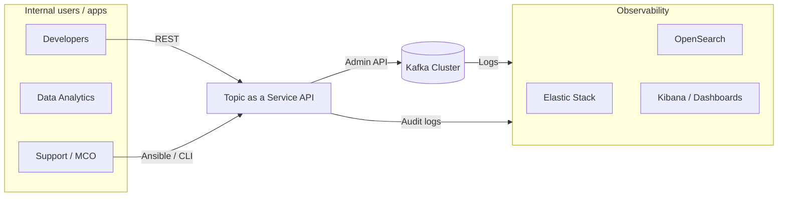

# Reference architecture

## Logical view

## Key components

- **Kafka Cluster**: high-volume messaging backbone (multi-broker, multi-AZ in prod)
- **Topic-as-a-Service**: standardizes topic creation, naming, retention, configs, ownership
- **KafkaOps CLI**: standardized operational commands (health, topic drift, lag)
- **Ansible automation**: idempotent playbooks for checks, evidence, topic catalog
- **Observability**: logs + metrics + dashboards for proactive operations

## Non-functional targets

- Reliability (SLO, runbooks, incident response)
- Performance (capacity planning, partitions strategy, IO/network tuning)
- Security (TLS/SASL, ACLs, audit)
- Operability (automated checks, reproducible changes, evidence)
