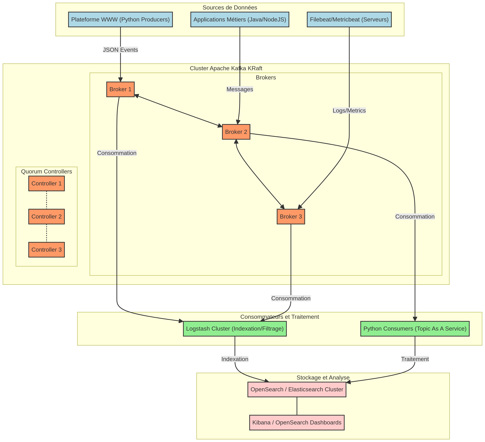

# Architecture Kafka

**Auteur :** Zidane Djamal (Architect HLD/DDL Kafka)

Ce répertoire contient les documents d'architecture de la plateforme Kafka pour l'équipe Data Analytics.

## Documents

| Document | Description |
| :--- | :--- |
| `HLD_Kafka.md` | **High Level Design** : Architecture globale, composants, flux de données et objectifs. |
| `DDL_Kafka.md` | **Detailed Design** : Configurations techniques, dimensionnement, sécurité, intégration Elastic Stack. |
| `hld_diagram.png` | Diagramme d'architecture de haut niveau (généré depuis `hld_diagram.mmd`). |
| `hld_diagram.mmd` | Source Mermaid du diagramme d'architecture. |

## Diagramme d'Architecture

